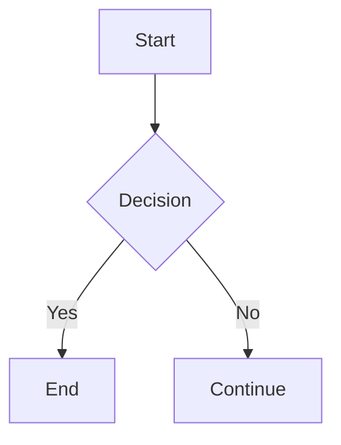
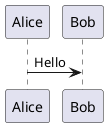

# Complete Markdown Syntax Reference

Here is a full reference of Markdown syntax, organized by category. Support varies between renderers (GitHub, Typora, Obsidian, VS Code, etc.).

<!-- more -->

------

## Headings

```markdown
# Heading 1
## Heading 2
### Heading 3
#### Heading 4
##### Heading 5
###### Heading 6
```

Alternative (Setext style, only levels 1 and 2):

```markdown
Heading 1
=========

Heading 2
---------
```

------

## Paragraphs and Line Breaks

```markdown
This is the first paragraph.

This is the second paragraph (separated by a blank line).

End a line with two spaces  
to force a line break.

Or use a backslash\
to force a line break.
```

------

## Emphasis

```markdown
*italic* or _italic_
**bold** or __bold__
***bold italic*** or ___bold italic___
~~strikethrough~~ (extended)
==highlight== (extended, supported by some renderers)
```

------

## Lists

### Unordered Lists

```markdown
- Item one
- Item two
  - Sub-item
    - Sub-sub-item
* Asterisk also works
+ As does plus
```

### Ordered Lists

```markdown
1. First item
2. Second item
   1. Sub-item
   2. Sub-item
```

### Task Lists (extended, supported by GitHub)

```markdown
- [x] Completed task
- [ ] Incomplete task
```

------

## Links

```markdown
[Link text](https://example.com)
[Link text](https://example.com "Hover tooltip")
<https://example.com>           autolink
<email@example.com>             email autolink

[Reference-style link][id]
[id]: https://example.com "Title"

[Relative link](../path/file.md)
```

### Anchor Links

```markdown
[Jump to heading](#1-headings)
```

------

## Images

```markdown


![Alt text][imgid]
[imgid]: image.png "Image title"

<!-- Image with a link -->
[](https://example.com)

<!-- Controlling size (extended, some renderers) -->

```

------

## Code

### Inline Code

```markdown
Use `console.log()` to output.
```

### Fenced Code Blocks

~~~markdown
```javascript
function hello() {
  console.log("Hello");
}
```
~~~

### Indented Code Blocks

```markdown
    Four spaces of indentation
    also creates a code block
```

------

## Blockquotes

```markdown
> This is a quote
> spanning multiple lines

> Nested quotes
>> Second level
>>> Third level
```

Blockquotes can contain other syntax:

```markdown
> **Bold** and `code`
> - List item
```

------

## Horizontal Rules

```markdown
---
***
___
```

------

## Tables (extended)

```markdown
| Left-aligned | Centered | Right-aligned |
|:-------------|:--------:|--------------:|
| A            | B        | C             |
| 1            | 2        | 3             |
```

Alignment is set by colons: `:---` left, `:---:` center, `---:` right.

------

## Escaping Characters

Prefix special characters with a backslash `\`:

```markdown
\* not italic \*
\` not code \`
\# not a heading
\\ a literal backslash
```

Escapable characters: `\` ``` `*` `_` `{}` `[]` `()` `#` `+` `-` `.` `!` `|`

------

## Inline HTML

```markdown
<p align="center">Centered paragraph</p>
<br>
<kbd>Ctrl</kbd> + <kbd>C</kbd>
<details>
<summary>Click to expand</summary>
Hidden content
</details>
<sup>superscript</sup> <sub>subscript</sub>
```

------

## Footnotes (extended)

```markdown
Here is a footnote[^1].

[^1]: The footnote content.
```

------

## Definition Lists (extended, some renderers)

```markdown
Term
: Definition of the term
```

------

## Math (extended, requires MathJax/KaTeX)

```markdown
Inline math: $E = mc^2$

Block math:
$$
\int_a^b f(x)\,dx
$$
```

------

## Diagrams (extended)

### Mermaid Flowchart

~~~markdown

~~~

### Other Diagram Tools (some renderers)

~~~markdown

~~~

------

## Table of Contents (TOC, extended)

```markdown
[TOC]
```

Or manually:

```markdown
- [Heading One](#heading-one)
- [Heading Two](#heading-two)
```

------

## Comments (extended/HTML)

```markdown
<!-- This comment will not be rendered -->
[//]: # (This is also a comment)
```

------

## Badges (GitHub, essentially linked images)

```markdown

```

------

## Other Extended Syntax

```markdown
==highlight==               (partially supported)
~~strikethrough~~           (supported by GitHub)
H~2~O                      subscript (partially supported)
x^2^                       superscript (partially supported)
:smile:                    emoji shortcodes (GitHub)
@username                  mention (GitHub)
#123                       reference an issue (GitHub)
```

